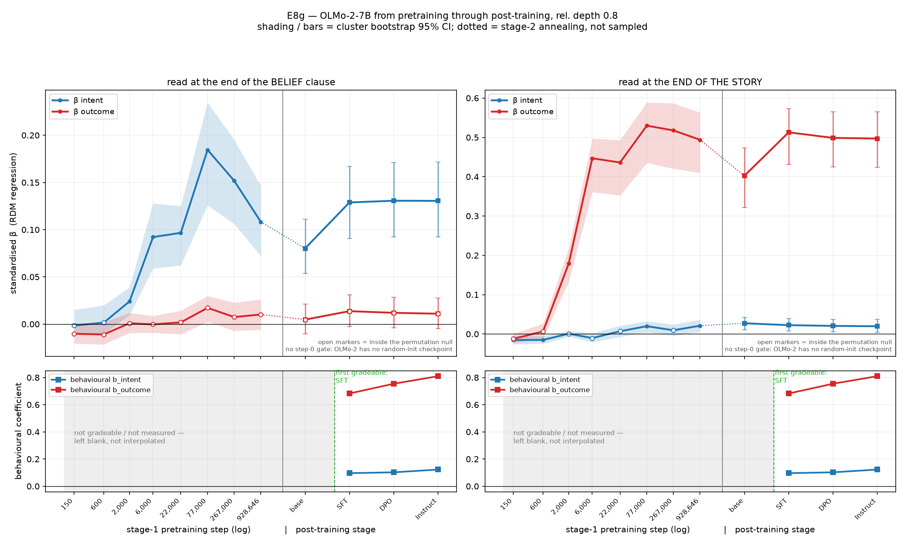

# E8g — OLMo-2-7B: does the Pythia dissociation replicate?

**REPLICATES** under the rule in `E8_PRESPEC.md` amendment 3.1, fixed before any OLMo β was computed: read at the last stage-1 revision (step 928,646), the pattern holds at **5 of 5** depths at `belief_last` (intent clears, outcome does not) and **4 of 5** at `last` (outcome clears, intent does not); ≥ 3 of 5 needed per position. Pythia-1.4B under the same rule: 5 of 5 and 4 of 5.

Eight stage-1 revisions (150 … 928,646); cluster-bootstrap CIs; 1000 permutations per cell. **No step-0 gate**: OLMo-2 publishes no random-init checkpoint, so nothing here was checked against an untrained network of this family; Pythia's passing gate covers only the RDM construction and predictors the two share.

## The rule, cell by cell (primary spec, last stage-1 revision)

| position | depth | target | β target | cluster 95% CI | null q97.5 |β| | target clears | β other | other clears | pattern holds |
|---|---|---|---|---|---|---|---|---|---|
| `belief_last` | 0.2 | intent | +0.078 | [+0.047, +0.111] | 0.015 | yes | +0.016 | no | **yes** |
| `belief_last` | 0.4 | intent | +0.231 | [+0.172, +0.291] | 0.015 | yes | +0.015 | no | **yes** |
| `belief_last` | 0.6 | intent | +0.172 | [+0.123, +0.225] | 0.016 | yes | +0.006 | no | **yes** |
| `belief_last` | 0.8 | intent | +0.108 | [+0.072, +0.147] | 0.014 | yes | +0.010 | no | **yes** |
| `belief_last` | 1.0 | intent | +0.081 | [+0.056, +0.105] | 0.013 | yes | +0.015 | no | **yes** |
| `last` | 0.2 | outcome | +0.413 | [+0.323, +0.511] | 0.019 | yes | +0.011 | no | **yes** |
| `last` | 0.4 | outcome | +0.516 | [+0.446, +0.580] | 0.019 | yes | +0.041 | yes | **no** |
| `last` | 0.6 | outcome | +0.543 | [+0.470, +0.609] | 0.018 | yes | +0.031 | no | **yes** |
| `last` | 0.8 | outcome | +0.494 | [+0.410, +0.563] | 0.017 | yes | +0.021 | no | **yes** |
| `last` | 1.0 | outcome | +0.419 | [+0.332, +0.479] | 0.019 | yes | +0.022 | no | **yes** |

## Across training (descriptive)

At depth 0.8, the first stage-1 revision from which the target factor clears its band and stays clear through step 928,646:

- `last`, outcome: step 2,000
- `belief_last`, intent: step 2,000

The onset is bracketed, not pinned: `last` outcome: inside its null at step 600 (3B tokens), clear from step 2,000 (9B tokens); `belief_last` intent: inside its null at step 600 (3B tokens), clear from step 2,000 (9B tokens). Eight revisions cannot place it more finely. Steps are not comparable across families at face value (OLMo-2 stage 1 is ~4.2M tokens per step, Pythia ~2.1M); in tokens, Pythia's outcome structure at `last` clears from step 1,000 (~2.1B tokens) and its intent structure at `belief_last` from step 3,000 (~6.3B), both inside or just below OLMo's bracket. Same order of magnitude, and nothing finer is claimed.

Shape fits at n = 8 (amendment 3: reported, not scored):

| position | depth | predictor | ΔAICc (piecewise − sigmoid) | R² sigmoid | 75's label |
|---|---|---|---|---|---|
| `belief_last` | 0.8 | intent | -2.713 | 0.8686 | breakpoint (changepoint UNLOCATED) |
| `belief_last` | 0.8 | outcome | -1.87 | 0.804 | indistinguishable |
| `last` | 0.8 | intent | 0.376 | 0.8323 | indistinguishable |
| `last` | 0.8 | outcome | 13.404 | 0.9868 | smooth |

## Post-training stages (descriptive; same regression, same depths)

| stage | position | depth | β intent | β outcome |
|---|---|---|---|---|
| base | `belief_last` | 0.8 | +0.080 | +0.005 |
| base | `last` | 0.8 | +0.027 | +0.402 |
| SFT | `belief_last` | 0.8 | +0.129 | +0.014 |
| SFT | `last` | 0.8 | +0.022 | +0.513 |
| DPO | `belief_last` | 0.8 | +0.131 | +0.012 |
| DPO | `last` | 0.8 | +0.021 | +0.499 |
| Instruct | `belief_last` | 0.8 | +0.131 | +0.011 |
| Instruct | `last` | 0.8 | +0.020 | +0.497 |

Descriptively, at depth 0.8: intent at `belief_last` goes +0.108 (last stage-1) → +0.080 (base) → +0.129 (SFT) → +0.131 (Instruct), and outcome at `last` goes +0.494 → +0.402 → +0.513 → +0.497. Both dip across the unsampled stage-2 interval and recover at SFT, after which DPO and RLVR leave them where they are. The dissociation itself is intact at every stage: the off-target factor stays near zero throughout. Whether the dip belongs to annealing or to the float16/float32 seam cannot be told apart from these data.

Two seams on the joined axis: the stage activations were extracted at float16 and the stage-1 revisions at float32; and `base` includes stage-2 annealing, which E8g did not sample, so the last stage-1 point and `base` are different weights joined by a dotted line.

## Limits

- Eight revisions, by scope decision (amendment 3). The full ~20-revision sweep would sharpen the timing, not the verdict, which is read at one revision.
- No step-0 gate for this family.
- The behavioural panel shows post-training stages only, from `checkpoint_dissection.csv`; OLMo stage-1 revisions were not behaviourally scored, and OLMo base itself is below the engagement floor.
