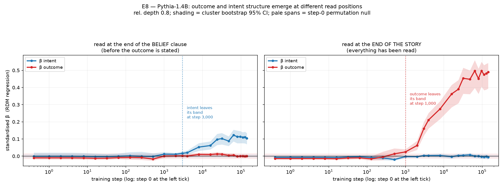

# E8 — representational emergence across training checkpoints

**pythia-1.4b, 26 checkpoints from random initialisation to step 143,000, 298 items, 5 relative depths × 2 read positions.**

Pre-registered in `outputs/experiments/E8_PRESPEC.md` (tag `prespec-e8`) with two amendments, both written before the checkpoint that they bear on was analysed. Every number below is read back out of `checkpoint_betas.csv` and `checkpoint_shape_fits.csv`.

---

## Headline

**Outcome structure and intent structure both emerge, smoothly, at around step 1,000–3,000 — but at different read positions, and each is invisible at the other's.** At the end of the story the geometry is organised by outcome (β reaches +0.49) and intent never leaves its null. At the end of the belief clause the geometry is organised by intent (β reaches +0.10) and outcome never leaves its null. Neither emergence is a step change: the sigmoid beats the free-changepoint model in every informative cell.

---

## The pre-registered predictions

| | prediction | verdict |
|---|---|---|
| **P0** | step-0 gate | **PASS** — see `E8_STEP0_GATE.md`. 0 of 20 intent/outcome predictor-cells outside even the uncorrected 95% band. |
| **P1** | outcome leaves its band before intent, at the primary cell | **FAILS** — at the primary cell outcome *never* leaves its band and intent leaves at step 3,000. |
| **P2** | outcome share non-decreasing after step 1,000 | **FAILS** at the primary cell (ρ = -0.639, 95% CI [-0.935, -0.113]). |
| **P3** | anything quoted is above its own null | holds — every β quoted here clears its permutation band and its cluster-bootstrap CI clears it too. |
| **P4** | breakpoint beats sigmoid, changepoint located | **FAILS, toward smooth** — across the primary spec the shape verdicts are smooth 17, indistinguishable 2, breakpoint 1. |

P1 and P4 were both falsified, in opposite directions from the ones the design document expected to be interesting. Both are reported as they fell.

---

## Why P1 failed, and why the primary cell could not have tested it

The primary cell was fixed in advance as relative depth 0.8 at `belief_last`, on the reasoning that this is the position at which intent is representable *before the harm is mentioned*. That reasoning is right about intent and it is exactly what makes the cell unable to test P1.

**A causal language model reading the token at the end of the belief clause has not yet read the outcome.** The harm-or-no-harm manipulation occurs later in the text, so its information is not in the context window at that position and cannot be in the activation. β_outcome ≈ 0 at `belief_last` is forced by the architecture and the stimulus ordering; it is not a fact about Pythia and it is not evidence about when outcome structure emerges.

This is a design error in the prespec, found after the fact. It is reported rather than repaired by moving the primary cell, because the whole point of fixing the cell in advance was to prevent exactly that move. What rescues the analysis is that section 5 *also* pre-registered running all cells and reporting the distribution, and said that a primary-versus-majority disagreement would be the headline rather than a footnote. It is.

---

## What the two positions show

| | `belief_last` (before the outcome is stated) | `last` (whole story read) |
|---|---|---|
| intent — emerges | step 3,000 | **never leaves its null** |
| intent — β at step 143,000 | +0.1042 | -0.0065 |
| outcome — emerges | **never leaves its null** | step 1,000 |
| outcome — β at step 143,000 | +0.0003 | +0.4899 |

The pattern is the same at every depth from 0.2 to 1.0 and under both all-pairs specifications:

| spec | position | outcome emerges at | intent emerges at |
|---|---|---|---|
| `primary` | `last` | 1,000–2,000 | 96,000 (1/5 depths) |
| `primary` | `belief_last` | never (all depths) | 3,000–64,000 |
| `no_lexical` | `last` | 1,000 | 143,000 (1/5 depths) |
| `no_lexical` | `belief_last` | 64,000 (1/5 depths) | 8,000 (4/5 depths) |

**The pre-registered no-lexical sensitivity passes.** Amendment 1 committed in advance to treating a disagreement between the `primary` and `no_lexical` specifications about P1's ordering as meaning P1 is not established. They do not disagree: the ordering, the sign and the emergence window are the same with and without the lexical covariate. The `within_scenario` specification is reported in the CSV and, as predicted, is dominated by the lexical collinearity (VIF ≈ 4.4); nothing is gated on it.

---

## Gradual, not a click (P4)

The sigmoid in log(step) beats the free-changepoint model in **every** informative cell, by a wide margin:

| position | predictor | ΔAICc (− favours breakpoint) | sigmoid R² | verdict |
|---|---|---:|---:|---|
| `last` @ 0.2 | `outcome` | +36.53 | 0.9878 | smooth |
| `last` @ 0.4 | `outcome` | +42.27 | 0.9964 | smooth |
| `last` @ 0.6 | `outcome` | +16.53 | 0.9962 | smooth |
| `last` @ 0.8 | `outcome` | +31.96 | 0.9952 | smooth |
| `last` @ 1.0 | `outcome` | +32.52 | 0.9944 | smooth |
| `belief_last` @ 0.2 | `intent` | +20.13 | 0.9493 | smooth |
| `belief_last` @ 0.4 | `intent` | +17.97 | 0.9897 | smooth |
| `belief_last` @ 0.6 | `intent` | +19.39 | 0.9911 | smooth |
| `belief_last` @ 0.8 | `intent` | +18.55 | 0.9833 | smooth |
| `belief_last` @ 1.0 | `intent` | +18.45 | 0.9739 | smooth |

This is the result that the caveat in the prespec was written for. Apparent sharp emergence in language models is frequently an artifact of a thresholded measure — discontinuous scoring manufactures phase transitions that continuous measures dissolve (Schaeffer et al., *Are Emergent Abilities of Large Language Models a Mirage?*). Standardised β is continuous and unthresholded, so a breakpoint found here would have been a stronger claim than the usual one. There is no breakpoint. Both factors come in as smooth sigmoids in log(step), and that is reported as plainly as a breakpoint would have been.

---

## Non-triviality check

The prespec required a check that this is not simply "later checkpoints have more structure of every kind". It is not. At `last`, outcome rises from ~0 to +0.49 while **intent stays flat at ~0 for the entire 143,000 steps** — the two factors are measured in the same regression, on the same RDM, against the same covariates. Whatever is sharpening, it is not sharpening both factors.

---

## Limits

- One model family, one size, 298 items that are **204 distinct texts** (94 rows are word-for-word YS2009 reprints of YS2008 scenarios; see `CONTAMINATION_REPAIR.md` §6). All CIs shown are the cluster bootstrap over the 53 scenario groups, which is the resampling whose independence assumption holds.
- Descriptive geometry over training time. Nothing here is causal; E7's erasure results are the causal arm.
- The behavioural series (E8f) is not in this document. It is a separate panel and it cannot falsify P1–P4.
- Checkpoint trajectories for theory of mind already exist and track behavioural accuracy on false-belief items. E8's difference is that it tracks representational geometry for the moral belief × outcome factors, and that the Young & Saxe 2×2 has not previously been run along a pretraining trajectory. That is a difference in measurement, not a priority claim over the trajectory method.
